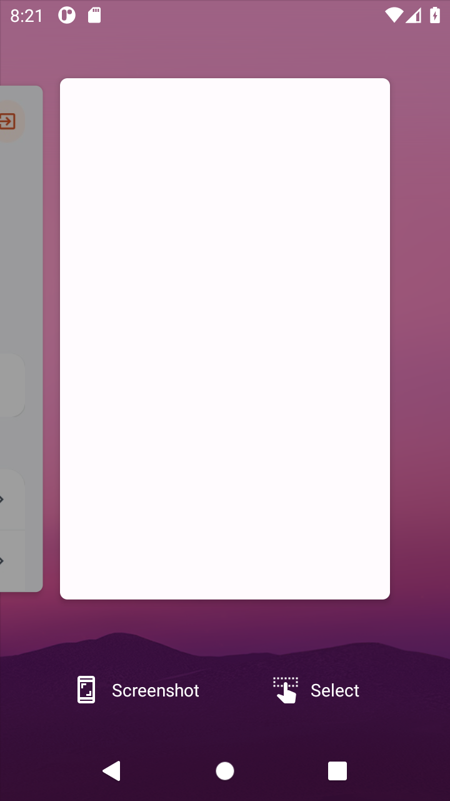
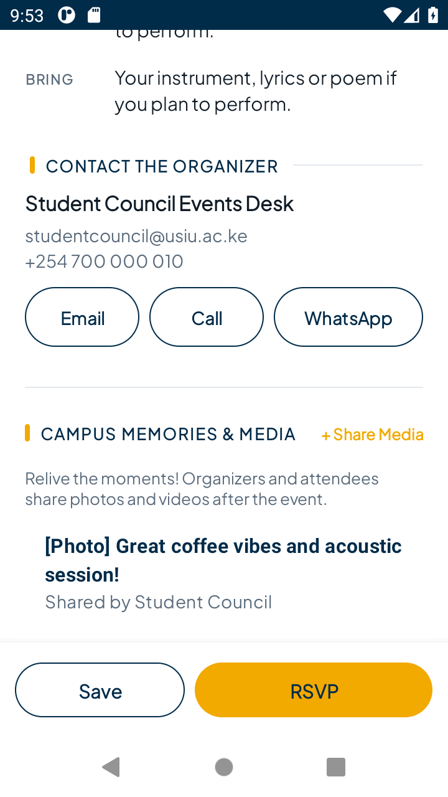
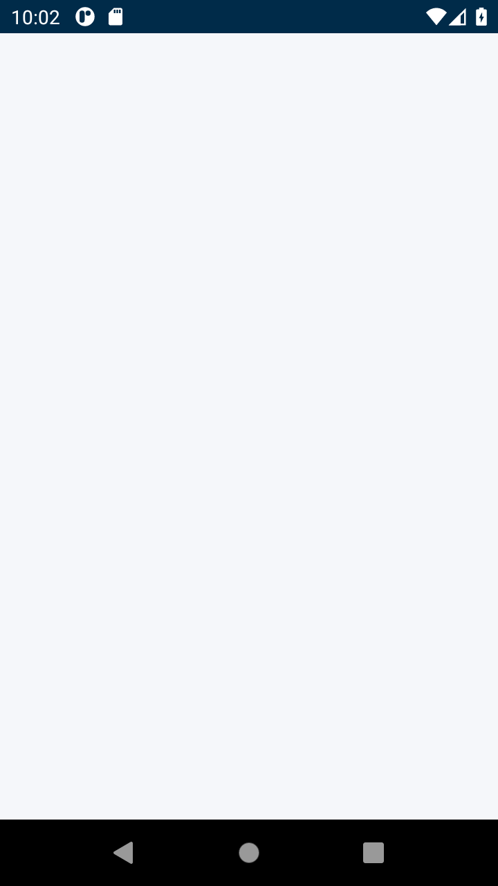

# CampusPulse

**Your campus. Your community. One pulse.**

CampusPulse is a native Android campus companion application designed to bring university life together in one place. It helps students stay informed about campus events, follow their favourite sports teams, track fixtures and results, manage their academic schedules, and keep up with important campus notifications.

The project consists of a Java-based Android application and a Django REST Framework backend, supported by a staff management dashboard.

## Screenshots

| Welcome | Home |
|---|---|
|  |  |

| Events | Event Details |
|---|---|
|  |  |

| Login | Live Application |
|---|---|
|  |  |

## Features

### Student Application

- **Authentication and onboarding:** Student registration, login, and onboarding experience.
- **Campus events:** Discover campus events and access event details.
- **Event reminders:** Receive locally scheduled reminders for upcoming events.
- **Academic planning:** Access weekly schedules and academic calendar information.
- **Sports:** Explore campus sports fixtures, upcoming matches, and results.
- **Favourite teams:** Follow teams and access their profiles and fixtures.
- **Notifications:** View relevant campus and application notifications.
- **Student profile:** Access personal profile information and preferences.

### Staff Management

The Django backend also provides a staff-facing management dashboard with functionality for:

- Managing campus events.
- Updating event media.
- Viewing and managing event RSVPs.
- Accessing RSVP records and CSV exports.
- Managing user records.
- Reviewing timetable conflicts.

### Sports Management

CampusPulse supports multiple campus sports, including:

- Basketball
- Football
- Netball
- Rugby

The sports module supports fixtures, match information, scores, results, and favourite-team tracking.

## Technology Stack

| Component | Technologies |
|---|---|
| Android application | Java, XML |
| Android development | Android SDK, Gradle |
| UI components | Material Components, RecyclerView, CardView |
| API communication | Retrofit, Gson, OkHttp |
| Image loading | Glide |
| Background tasks | Android WorkManager |
| Backend | Python, Django |
| API | Django REST Framework |
| Authentication | JWT (Simple JWT) |
| Database | SQLite development configuration |
| Version control | Git and GitHub |

## Architecture

CampusPulse follows a client-server architecture.

```text
+----------------------------------+
|       CampusPulse Android        |
|                                  |
|  Java Activities and Fragments   |
|  XML Layouts                     |
|  Data Models and Repository      |
|  Retrofit API Client             |
|  Authentication Management      |
|  WorkManager Reminders           |
+----------------+-----------------+
                 |
                 | HTTP / JSON
                 | JWT Authentication
                 |
+----------------v-----------------+
|         Django Backend           |
|                                  |
|  Django REST Framework           |
|  Authentication and Authorization|
|  API Views and Serializers       |
|  Events and Academic Schedules   |
|  Sports and Fixtures             |
|  Teams and Notifications         |
|  Staff Management Dashboard     |
+----------------+-----------------+
                 |
+----------------v-----------------+
|             Database             |
|                                  |
|       SQLite (Development)       |
+----------------------------------+
